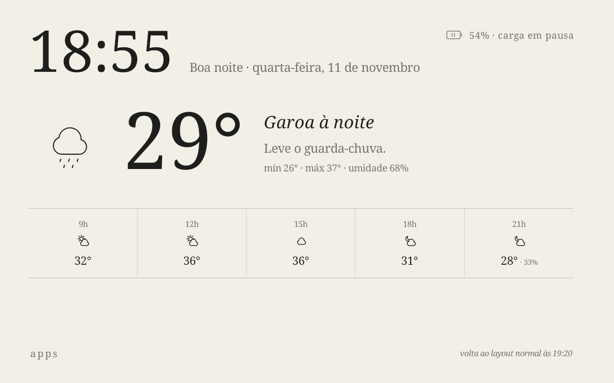

# tablet-e-ink

**Relógio de cabeceira estilo e-ink + leitor tipo Kindle num tablet Android barato.**

Um tablet de entrada vira um relógio de cabeceira elegante — hora grande em serifa, papel de dia,
âmbar à noite — que também mostra o tempo e seus próximos compromissos, com um botão “Meus livros”
que abre o [ReadEra](https://play.google.com/store/apps/details?id=org.readera). Tudo instalado pelo
PC, via adb, **sem root**.

| Dia (papel) | Ao acordar | Noite (âmbar) |
|---|---|---|
|  |  |  |




> Capturas de tela feitas no aparelho. No tablet de teste as cores
> aparecem mais suaves por causa do filtro de saturação opcional (ver [Root opcional](#root-opcional)).

## O que faz
- **Dia:** data por extenso no canto, hora grande, tempo numa linha (ícone em traço fino,
  temperatura atual, mín/máx e um resumo como “chuva à tarde”) e, no rodapé, a lista dos apps
  instalados (um toque abre) e o cartão “Continuar lendo”, que abre o leitor.
- **Ao acordar:** na primeira hora depois da noite, a previsão do dia em destaque: resumo, um conselho
  (“Leve o guarda-chuva.”), mín/máx, umidade e uma faixa das 9h às 21h com a chance de chuva.
- **Noite:** só a hora e a data, em âmbar e com brilho mínimo. Um toque mostra o botão do livro por 10 s.
- Transição suave entre dia e noite; layout vertical e horizontal; protetor de tela no carregador;
  indicador discreto de bateria; deslocamento periódico do conteúdo para proteger a tela.
- Sem internet, mostra o último tempo baixado com “atualizado às HH:MM”.
- App leve em Java puro (sem bibliotecas), pensado para Android Go com ~2 GB de RAM.

## Aparelho testado
**Multilaser M8 4G** (`ML_SO0V_M8_4G`, MediaTek MT6762, **Android 13 Go**, 2 GB de RAM) — detalhes em
[docs/01-diagnostico.md](docs/01-diagnostico.md).

Deve funcionar em outros tablets e celulares com Android 11 ou mais novo, **sem garantia**. A lista de
apps removidos pelo `etapa2-debloat.ps1` foi feita para o M8; em outro aparelho, revise-a ou use
`-SemDebloat`.

## Requisitos
- PC com **Windows** e PowerShell
- **adb** — [Android SDK Platform-Tools](https://developer.android.com/tools/releases/platform-tools)
- **Cabo USB** de dados
- No tablet: **Depuração USB** ligada, Android 11 ou mais novo
- Só se for compilar o app: **JDK 17** e o **Android SDK** (plataforma 34 + build-tools 34)

## Instalação (sem root)
1. **Depuração USB no tablet:** Configurações → Sobre o tablet → toque 7 vezes em “Número da versão”;
   depois Configurações → Sistema → Opções do desenvolvedor → **Depuração USB**.
2. **adb no PC:** extraia o platform-tools e coloque a pasta no `PATH`, ou indique o caminho:
   ```powershell
   $env:ADB = "C:\platform-tools\adb.exe"
   ```
   Conecte o tablet, aceite “Permitir depuração USB” e confira com `adb devices`.
   (Para não repetir isso, crie `scripts\local.ps1` com essa linha — o arquivo fica fora do git.)
3. **O app:** baixe o `cabeceira-vX.Y.Z.apk` da página de
   [Releases](https://github.com/ArReinaldo/tablet-e-ink/releases) — ou compile você mesmo
   (precisa de JDK 17 e Android SDK):
   ```powershell
   # uma vez: diga ao Gradle onde está o Android SDK
   Set-Content app-relogio\local.properties "sdk.dir=C\:\\Android\\sdk"
   cd app-relogio; .\gradlew.bat assembleDebug; cd ..
   ```
   O APK compilado sai em `app-relogio\app\build\outputs\apk\debug\app-debug.apk`.
4. **Instalar tudo** (baixe este repositório como ZIP ou com `git clone` e abra o PowerShell na pasta):
   ```powershell
   Set-ExecutionPolicy -Scope Process Bypass
   .\scripts\instalar-tudo.ps1 -Apk C:\Downloads\cabeceira-v0.4.1.apk              # Multilaser M8
   .\scripts\instalar-tudo.ps1 -Apk C:\Downloads\cabeceira-v0.4.1.apk -SemDebloat  # outros aparelhos
   ```
   (Sem `-Apk`, usa o APK que você compilou.)
   O script aplica os ajustes de sistema, remove apps desnecessários, baixa e instala o KOReader
   oficial e instala o relógio como tela inicial e protetor de tela.
5. **O leitor:** instale o [ReadEra](https://play.google.com/store/apps/details?id=org.readera) pela
   Play Store. Na primeira abertura, permita o acesso a todos os arquivos para ele encontrar os livros
   sozinho. Testado no M8 sem conta Google, com a versão 25.04.26.

   **Alternativa de código aberto:** o [KOReader](https://koreader.rocks/), instalado pelo script. O
   botão do relógio abre o KOReader quando o ReadEra não está instalado.

Cada etapa também pode ser rodada sozinha e desfeita com `-Desfazer`:

| Script | O que faz |
|---|---|
| `scripts\etapa2-config.ps1` | desliga animações; tela ligada no carregador; modo monocromático |
| `scripts\etapa2-debloat.ps1` | remove apps para o usuário 0 (`pm uninstall --user 0`) |
| `scripts\etapa3-ativar.ps1` | instala o relógio; tela inicial; protetor de tela; sem tela de bloqueio de deslizar |
| `scripts\config-relogio.ps1` | baixa/envia a configuração |

## Configuração
Tudo fica num arquivo, `cabeceira.conf`, na pasta do app no tablet
(`/sdcard/Android/data/br.tabletink.cabeceira/files/`). O relógio relê sozinho em até 1 minuto.

```powershell
.\scripts\config-relogio.ps1 -Baixar   # copia para a pasta config\ do projeto (fora do git)
# edite config\cabeceira.conf
.\scripts\config-relogio.ps1 -Enviar
```
Modelo comentado: [config.example](config.example).

- **Cidade:** troque `latitude` e `longitude`. Para achar as da sua cidade, abra
  `https://geocoding-api.open-meteo.com/v1/search?name=SUA_CIDADE&language=pt&countryCode=BR`.
- **Livro:** o cartão “Continuar lendo” mostra sozinho o último livro aberto no ReadEra e quanto
  já foi lido. Para isso o relógio lê o banco do ReadEra com root (conceda Superusuário ao
  “Cabeceira” no Magisk). Sem root, o cartão mostra só “Continuar leitura”.
- **Horários:** `noite_inicio` / `noite_fim` (padrão 21:00–06:00), `transicao_minutos`, `acordar_minutos`.

## Uso
- **Ler:** toque no cartão “Continuar lendo” (à noite, toque na tela e depois em “Meus livros”). Se o ReadEra ainda estiver aberto, ele volta ao livro; se tiver
  sido fechado, abre a tela inicial dele, com o livro atual em “Lendo agora”. Copie livros
  (EPUB, PDF, MOBI, AZW3, FB2, CBZ…) pelo cabo USB (modo Transferência de arquivos) para a pasta
  `Download`. Livros com DRM (ex.: comprados na Amazon) não abrem.
- **Trocar o modo à mão:** segure o dedo sobre a hora — alterna automático → dia → noite → automático.
- **Apps:** de dia, a lista fica no rodapé; ao acordar, toque em “apps” para abrir a lista completa.

### Sugestão: ler acompanhando o audiolivro (Spotify)
Instale o Spotify no tablet e toque o audiolivro enquanto lê o mesmo livro no leitor. O áudio
continua em segundo plano com a tela do leitor aberta. Os audiolivros dependem da sua conta e da sua
região.

- **Com Play Store:** instale normalmente.
- **Sem Play Store:** copie o app de outro aparelho. O Spotify vem dividido em vários APKs. Mande o
  `base.apk` **e todos os `split_config.*.apk`** (processador, densidade da tela e idioma), por exemplo
  `split_config.arm64_v8a.apk`, `split_config.hdpi.apk` e `split_config.pt.apk`. Só o `base.apk` dá
  `INSTALL_FAILED_MISSING_SPLIT`. Instale todos juntos:
  ```powershell
  adb install-multiple base.apk split_config.arm64_v8a.apk split_config.hdpi.apk split_config.pt.apk
  ```
  Os splits precisam servir no tablet. Confira com `adb shell getprop ro.product.cpu.abilist` e
  `adb shell wm density` (no M8: `arm64-v8a` e 240 = hdpi). Testado no M8 com o Spotify 9.1.94.

## Limite de carga
O relógio funciona **sem root**. Limitar a bateria em 85% (para um tablet que fica 24 h no carregador)
é **opcional**:
- **Sem root:** use uma **tomada inteligente** ou um **temporizador de tomada** no carregador.
- **Com root (Magisk):** um serviço do Magisk pausa a carga em 85% e retoma em 50%, e o indicador do
  relógio mostra “‖” quando a carga está pausada. Alternativa pronta: o módulo
  [ACC](https://github.com/VR-25/acc).

> ⚠️ Fazer root exige **desbloquear o bootloader, o que APAGA TODOS OS DADOS** do aparelho, pode anular
> a garantia e, se algo der errado, deixar o aparelho sem iniciar. **É por sua conta e risco.**
> O passo a passo do aparelho testado está em [docs/root-opcional/](docs/root-opcional/).

## Root opcional
[docs/root-opcional/](docs/root-opcional/) — backup pelo modo BROM (mtkclient), desbloqueio, Magisk,
limite de carga, cores suaves no sistema inteiro (saturação estilo Kindle Colorsoft) e bloqueio de
atualizações. Nada disso é necessário para o relógio e o leitor.

## Créditos
- [ReadEra](https://play.google.com/store/apps/details?id=org.readera) — o leitor indicado (app de terceiros, não incluído neste repositório).
- [KOReader](https://github.com/koreader/koreader) — leitor alternativo de código aberto (AGPL-3.0), instalado a partir das releases oficiais.
- [Open-Meteo](https://open-meteo.com/) — previsão do tempo e busca de cidades. *Weather data by
  [Open-Meteo.com](https://open-meteo.com/)* (dados sob [CC BY 4.0](https://creativecommons.org/licenses/by/4.0/)).
- [Noto Serif](https://fonts.google.com/noto/specimen/Noto+Serif) — a serifa do relógio, fonte do próprio Android (OFL).
- [Magisk](https://github.com/topjohnwu/Magisk) — root (opcional).
- [ACC — Advanced Charging Controller](https://github.com/VR-25/acc) — alternativa para o limite de carga (opcional).
- [mtkclient](https://github.com/bkerler/mtkclient) — backup pelo modo BROM (opcional).

## Licença
[MIT](LICENSE).
